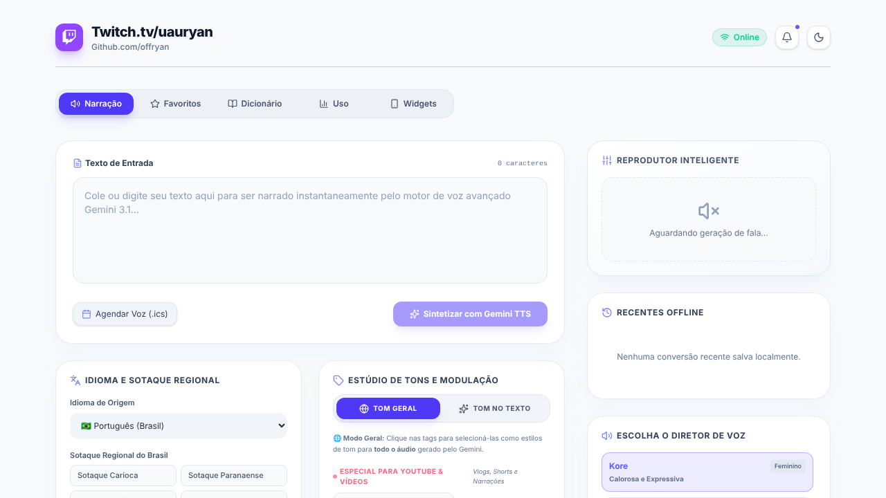

# 🗣️ Conversor de Texto em Fala com Gemini

Conversor de texto em fala usando o **Gemini 3.1 Flash TTS**, com sotaques regionais do Brasil, estúdio de tons para vídeos e painel de uso.



## ✨ Funcionalidades

- **Narração** de qualquer texto com 5 vozes do Gemini (Kore, Puck, Charon, Fenrir e Zephyr)
- **Sotaques regionais do Brasil:** carioca, paranaense, paulistano, nordestino, baiano, pernambucano, cearense e gaúcho
- **Outros idiomas:** inglês, espanhol, francês, italiano e alemão
- **Estúdio de tons:** tons clássicos (alegre, calma, séria...) e tons para YouTube (narrativa, didática, suspense, ASMR, promocional...), aplicados no áudio todo ou em trechos do texto
- **Dicionário de pronúncia** para ensinar como falar nomes e termos específicos
- **Favoritos e recentes** salvos no navegador
- **Painel de uso** com gráficos das conversões
- **Widgets** e agendamento de voz via arquivo `.ics`
- Tema claro e escuro

## 🛠️ Tecnologias

- **Front-end:** React 19, TypeScript, Vite, Tailwind CSS, Motion, Recharts, Lucide
- **Back-end:** Node.js com Express (`server.ts`), que chama a API do Gemini e devolve o áudio em WAV
- **IA:** Google Gemini (`@google/genai`), modelo `gemini-3.1-flash-tts-preview`

## ▶️ Rodando localmente

Pré-requisitos: Node.js 20+ e uma chave da [API do Gemini](https://aistudio.google.com/apikey).

```bash
git clone https://github.com/offryan/offryan-text-to-speech.git
cd offryan-text-to-speech
npm install            # ou: bun install
cp .env.example .env   # e coloque sua chave em GEMINI_API_KEY
npm run dev
```

Acesse `http://localhost:3000`.

Para produção: `npm run build` e depois `npm start`.

## 📄 Licença

© 2026 Ryan G. Santos. Todos os direitos reservados. O código está público apenas para portfólio e avaliação: não é permitido copiar, modificar, distribuir ou usar comercialmente sem autorização por escrito. Veja o arquivo [LICENSE](LICENSE).
